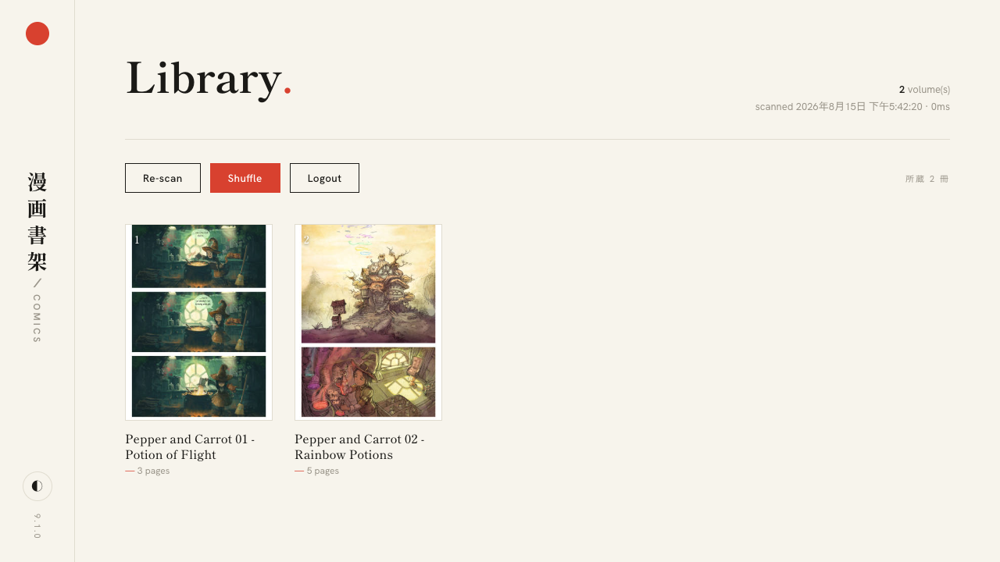
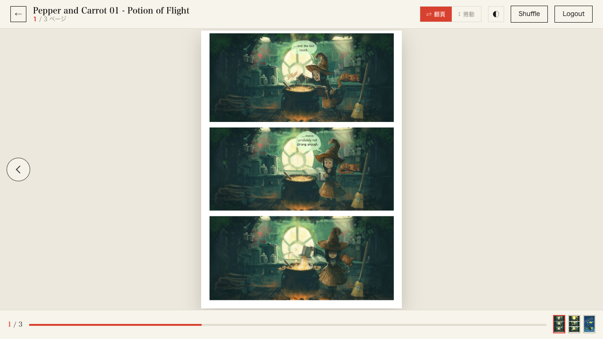
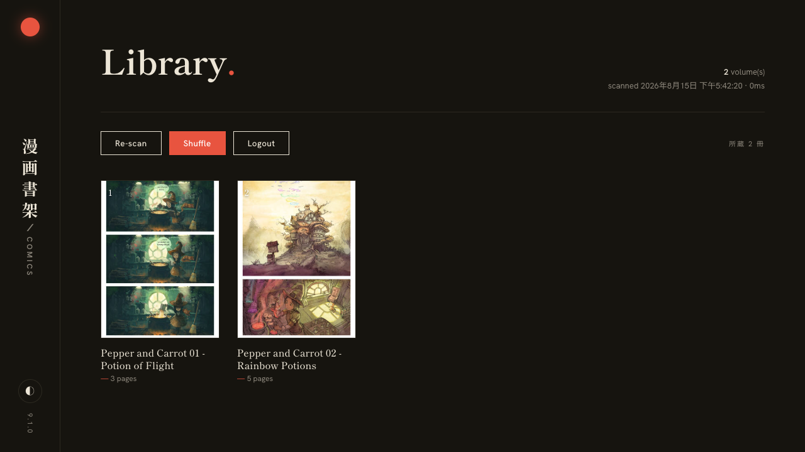
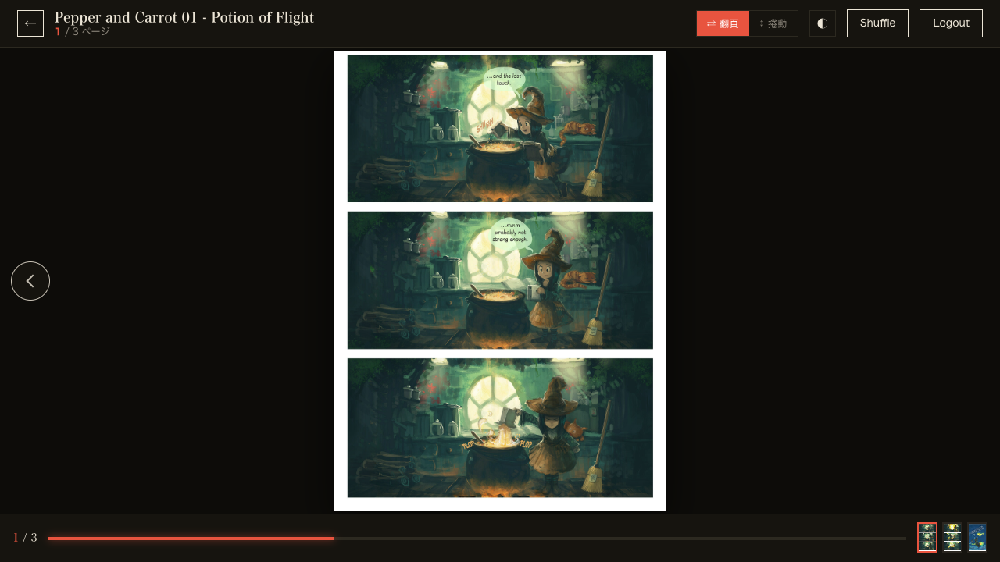

# Comics

[](https://github.com/henry40408/comics/actions/workflows/ci.yml)
[](https://codecov.io/gh/henry40408/comics)
[](https://github.com/henry40408/comics/releases/latest)
[](LICENSE.txt)
[](https://go.dev/)
[](https://ghcr.io/henry40408/comics)
[](https://casuallymaintained.tech/)
[](https://claude.com/claude-code)

A self-hosted file server for comic books.

|       | Library                                                        | Reader                                                       |
| ----- | -------------------------------------------------------------- | ----------------------------------------------------------- |
| Light |     |    |
| Dark  |       |      |

> Sample artwork: [Pepper&Carrot](https://www.peppercarrot.com/) by David Revoy, CC-BY 4.0.

## Background

Self-hosted comic readers such as [Calibre](https://github.com/janeczku/calibre-web), [Komga](https://github.com/gotson/komga) and [Tanoshi](https://github.com/faldez/tanoshi) can be complex to set up or restrictive about formats. Comics aims to be a straightforward alternative.

## Features

- **Simple structure**: each immediate subdirectory of the data directory is a book, and the images inside it are its pages. Nested folders are not scanned.
- **Manga-friendly reader**: right-to-left paging or continuous vertical scroll, switchable on the fly, with a progress bar, thumbnail strip, keyboard navigation and a light/dark theme. Covers and thumbnails are small JPEGs generated on demand and cached on disk. Paging still works with JavaScript disabled.
- **Web login**: an optional username/password form protecting every page, image and thumbnail. Sessions last 7 days, or 3 days without a visit, and logging out ends them on the server.

## Quick Start

Arrange your comics like this:

```
data
├── book1
│   ├── page1.jpg
│   └── page2.jpg
└── book2
    ├── page1.jpg
    └── page2.jpg
```

Then run the Docker image:

```bash
docker run -p 8080:8080 -v "$PWD/data:/data" -e COMICS_DATA_DIR=/data ghcr.io/henry40408/comics
```

or build from source (`go build -o comics ./cmd/comics`) and run `./comics` next to `data/`. Open http://localhost:8080/.

## Configuration

Every option except `COMICS_LOG_LEVEL` can also be passed as a flag; see `comics --help`.

| Variable | Description | Default |
| --- | --- | --- |
| `COMICS_AUTH_USERNAME` | Login username; auth is enabled only when this and the hash are both set | _(none — public)_ |
| `COMICS_AUTH_PASSWORD_HASH` | Argon2id hash from [`comics hash-password`](#hash-password); the server refuses to start on anything else | _(none — public)_ |
| `COMICS_SECRET` | At least 64 hex characters (`openssl rand -hex 32`); signs session cookies and salts book/page IDs | _(random per start)_ |
| `COMICS_COOKIE_SECURE` | Mark the session cookie `Secure` (serve over HTTPS) | _(off)_ |
| `COMICS_HSTS_MAX_AGE` | Send `Strict-Transport-Security` with this `max-age` in seconds (e.g. `63072000`) | _(off)_ |
| `COMICS_TRUSTED_PROXIES` | Comma-separated IPs/CIDRs of reverse proxies whose `X-Forwarded-For` is trusted (e.g. `172.16.0.0/12,10.0.0.2`) | _(empty — header ignored)_ |
| `COMICS_DISABLE_CSRF_GUARD` | Turn off the CSRF origin check | `false` |
| `COMICS_BIND` | Bind address (the Docker image sets `0.0.0.0:8080`) | `127.0.0.1:8080` |
| `COMICS_DATA_DIR` | Data directory | `./data` |
| `COMICS_CACHE_DIR` | Thumbnail cache directory | `comics-thumbs` under the system temp dir |
| `COMICS_LOG_FORMAT` | `text` or `json` | `text` |
| `COMICS_LOG_LEVEL` | `debug`, `info`, `warn` or `error`, case-insensitive (environment only, no flag) | `info` |

### Notes

- **`COMICS_SECRET`**: pass it through the environment or a secret file, never on a command line. Without it every book/page URL changes on restart; rotating it does the same. It does not affect how long sessions last.
- **Sessions** are held in memory, and the cookie carries only an opaque identifier, so logging out revokes a session immediately — and ends every session, since there is one account. **Restarting comics logs everyone out**, which doubles as a panic button for a leaked cookie. The cookie is `SameSite=Strict`, so following a link into comics from another site shows the login page even when signed in; reload and you are through.
- **Login throttling**: `POST /login` allows 5 failed attempts per client IP per 60 seconds, and 20 across all addresses together; further attempts get `429` with `Retry-After`. Successful logins do not count. Beyond 10 000 tracked addresses, new ones share a single 5-per-minute window. A sustained attack can lock *you* out too, but only until the current window ends.
- **`COMICS_TRUSTED_PROXIES`**: list the address your reverse proxy *connects from* (e.g. `127.0.0.1`, or `172.16.0.0/12` for a sibling Docker container), not your clients' range. Until it is set, every client behind the proxy shares one rate-limit bucket; trusting the header by default would let anyone bypass the limit by forging it. comics warns once when it ignores an `X-Forwarded-For`. With a chain of proxies, list every hop.
- **`COMICS_COOKIE_SECURE`**: comics does not terminate TLS, so it cannot detect HTTPS behind a proxy. Enable this only when the site is always served over HTTPS — on plain HTTP the browser drops the cookie and login appears to do nothing. It also renames the cookie to `__Host-comics_session`, logging everyone out once whenever it is toggled. Accepts `1`, `t`, `true`, `0`, `f`, `false` (as Go's `strconv.ParseBool`).
- **`COMICS_HSTS_MAX_AGE`**: prefer setting HSTS on your TLS-terminating proxy. Once a browser has seen the header it refuses plain HTTP to this host for the whole `max-age`. `includeSubDomains` and `preload` are deliberately not offered.
- **`COMICS_DISABLE_CSRF_GUARD`**: state-changing requests are checked with `Sec-Fetch-Site`, falling back to `Origin`. Browsers omit `Sec-Fetch-Site` on plain-HTTP non-localhost hosts (e.g. `http://nas.local`), and if they also send `Origin: null` the login form returns `403` with no way in. This flag is the escape hatch for that case; serving over HTTPS or through an SSH tunnel to `localhost` fixes it without giving anything up. `SameSite=Strict` still protects you with the flag on. Accepts `1`, `t`, `true`, `0`, `f`, `false` (as Go's `strconv.ParseBool`).
- **Security headers**: every response carries a strict `Content-Security-Policy` (`default-src 'none'`) and the usual hardening headers; they are not configurable. Make sure your reverse proxy does not add its own CSP — two policies are intersected, usually yielding a blank page.
- **Audit logging**: logins, logouts, expiries, failures and throttling are logged at `INFO`/`WARN` with the `User-Agent` (never the session ID, username or password). The events tied to a login attempt or a logout (`login_failed`, `login_rate_limited`, `login_lockout`, `session_created`, `session_destroyed`) also carry the client IP; the events about an existing cookie (`session_expired`, `session_rejected`, `session_user_agent_changed`) do not, so match those to a client through your reverse proxy's access log. Worth alerting on: `session_rejected` with `reason=bad_signature` or `reason=malformed` (a cookie this server never issued), and `login_lockout` (the account-wide budget is spent). Per-client throttling logs `login_rate_limited` with a `scope` of `per_ip` or `shared`. Setting `COMICS_LOG_LEVEL=warn` drops the `INFO` events (`session_created`, `session_destroyed`, `session_expired`); every failure and throttling event is `WARN` and still logs.
- **Upgrading**: the server refuses to start while the old unprefixed `AUTH_USERNAME` or `AUTH_PASSWORD_HASH` is set, and names its replacement: ignoring them would silently serve comics without authentication. The other retired variables are ignored without a word, so check your environment and rename them: `BIND`, `DATA_DIR`, `CACHE_DIR` and `LOG_FORMAT` gained the `COMICS_` prefix, `SEED`, `COMICS_SEED` and `COMICS_SESSION_KEY` became `COMICS_SECRET`, and `RUST_LOG` became `COMICS_LOG_LEVEL`. Moving to `COMICS_SECRET` logs everyone out and changes every book/page URL once. Only Argon2id password hashes are accepted: any other `COMICS_AUTH_PASSWORD_HASH` (bcrypt, Argon2i, …) is refused at startup, so re-run `comics hash-password` with the same password. `--log-format full` is now `text`, and the `-b` flag and the `ls` alias are gone (`--bind` and `list` remain); each makes an old start-up command fail with exit code 2.

## Commands

### `hash-password`

```bash
$ comics hash-password
Password:
Confirmation:
$argon2id$v=19$m=19456,t=2,p=1$...
```

Only the hash goes to stdout, so `COMICS_AUTH_PASSWORD_HASH=$(comics hash-password)` works. Passwords may be up to 1 KiB (about 341 Traditional Chinese characters). An empty password is refused; one shorter than 15 characters prints a warning on stderr but is still hashed.

### `list`

```bash
$ comics list
Book Title 1 (10P)
Book Title 2 (5P)
2 book(s), 15 page(s), scanned in 1.23ms
```

## License

MIT
